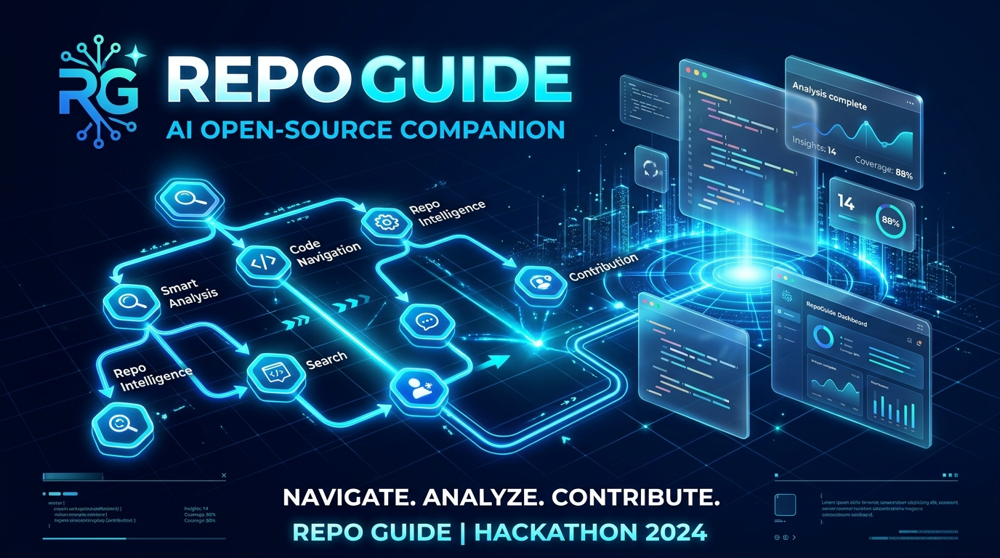

# 🧭 RepoGuide — AI Open-Source Companion



> **Built for Hacktoberfest Hack Day Delhi x Braveon AI & RoundTable DTU**  
> **Target Prize:** 🏆 **Best Open-Source AI Project (DigitalOcean)**  
> **Author:** Yash Kumar | Delhi Technological University (DTU) | October 31, 2026  
> **License:** MIT License  

---

## 💡 What is RepoGuide?

Open-source can be overwhelming for beginners. A newcomer opens a large codebase (like FastAPI or Flask), gets buried under hundreds of directories, configuration files, and unfamiliar terminology, feels lost, and gives up.

**RepoGuide solves this in under 60 seconds.**

The user pastes any public GitHub repository URL, and an open-weight Large Language Model served via **DigitalOcean Gradient AI Serverless Inference** generates an instant, easy-to-understand onboarding guide in **Hinglish**, **Hindi**, or **English**:

1. **What this project does**: Clear, jargon-free summary in 3–5 simple lines.
2. **Where things live**: A bird's-eye architecture map explaining which folders/files do what without hallucinations.
3. **How to run it locally**: Exact, verified setup and run steps based strictly on the repository's README.
4. **Where to start contributing**: Real beginner tasks linking directly to live `good first issue` tickets.
5. **🛠️ Interactive PR Plan Generator**: Step-by-step Git bash commands (`clone`, `branch`, `commit`, `push`) and ready-to-paste Pull Request description templates for any selected issue!

---

## 🌊 Why it Fits the DigitalOcean Best Open-Source AI Project Prize

This project is built from the ground up around **open-source AI and DigitalOcean infrastructure**:

1. **Open-Weight LLMs via DigitalOcean Serverless Inference**:
   Instead of proprietary closed APIs, RepoGuide uses open-weight models like **Alibaba Qwen3-32B** and **Meta Llama-3.1-70B-Instruct** served directly through **DigitalOcean Gradient AI Serverless Inference** (`https://inference.do-ai.run/v1`).
2. **Zero-Lock-in OpenAI-Compatible Interface**:
   Utilizes the standard OpenAI Python SDK configured with DigitalOcean endpoints and model IDs.
3. **Hosted on DigitalOcean App Platform**:
   Engineered for frictionless deployment on DigitalOcean App Platform with native Python auto-detection, port 8080 binding, and environment secret injection.
4. **100% Open Source**:
   Published under the permissive **MIT License** with modular agent skill support (`SKILL.md`).

---

## 🏗️ Architecture & Data Flow

```text
  ┌─────────────────────────────────────────────────────────┐
  │                 User pastes GitHub URL                  │
  │        (e.g., https://github.com/fastapi/fastapi)       │
  └────────────────────────────┬────────────────────────────┘
                               │
                               ▼
  ┌─────────────────────────────────────────────────────────┐
  │               Streamlit UI (app.py)                     │
  │     - Parses owner / repository name                    │
  │     - Language selector: Hinglish / Hindi / English     │
  │     - Model selector: Qwen3-32B / Llama-3.1-70B         │
  └────────────────────────────┬────────────────────────────┘
                               │
                               ▼
  ┌─────────────────────────────────────────────────────────┐
  │                  GitHub REST API                        │
  │  1. GET /repos/{owner}/{repo} (Metadata)               │
  │  2. GET /repos/{owner}/{repo}/readme (Base64 decode)    │
  │  3. GET /repos/{owner}/{repo}/git/trees/{branch}?rec=1  │
  │  4. GET /repos/{owner}/{repo}/issues?labels=good+first+issue │
  └────────────────────────────┬────────────────────────────┘
                               │
                               ▼
  ┌─────────────────────────────────────────────────────────┐
  │                 Prompt Builder Engine                   │
  │  - Truncates README to 6,000 characters                │
  │  - Extracts & filters top 250 source file paths         │
  │  - Formats real open beginner issues                    │
  └────────────────────────────┬────────────────────────────┘
                               │
                               ▼
  ┌─────────────────────────────────────────────────────────┐
  │  DigitalOcean Serverless Inference (Gradient AI)        │
  │  - Endpoint: https://inference.do-ai.run/v1             │
  │  - Open-Source Models: alibaba-qwen3-32b / Llama-3.1    │
  │  - Strips hidden <think>...</think> reasoning tags     │
  └────────────────────────────┬────────────────────────────┘
                               │
                               ▼
  ┌─────────────────────────────────────────────────────────┐
  │              Interactive Streamlit Dashboard            │
  │  - 4 Structured Beginner Sections                       │
  │  - Live Clickable Issue Cards                           │
  │  - 🛠️ Step-by-Step PR Plan Generator                    │
  │  - 📥 Markdown Export / Download Button                 │
  └─────────────────────────────────────────────────────────┘
```

---

## 📁 Repository Structure

```text
repo-guide/
├── app.py                      # Main Streamlit application (all logic & UI)
├── requirements.txt            # Python dependencies (streamlit, requests, openai)
├── README.md                   # Comprehensive project documentation
├── LICENSE                     # MIT License
├── SKILL.md                    # Antigravity/Agent skill definition
├── .gitignore                  # Prevents secrets and caches from being committed
├── .streamlit/
│   ├── config.toml             # Custom oceanic theme and server configuration
│   ├── secrets.toml.example    # Environment secrets template
│   └── secrets.toml            # Local secrets (git ignored)
└── assets/
    ├── banner.png              # Project banner and presentation graphics
    └── screenshot.png          # App screenshot for submission
```

---

## ⚡ Quickstart & Local Setup

### 1. Clone the repository
```bash
git clone https://github.com/<your-username>/repo-guide.git
cd repo-guide
```

### 2. Create and activate a virtual environment
```bash
# Windows
python -m venv venv
venv\Scripts\activate

# macOS / Linux
python3 -m venv venv
source venv/bin/activate
```

### 3. Install dependencies
```bash
pip install -r requirements.txt
```

### 4. Configure local secrets
Copy `.streamlit/secrets.toml.example` to `.streamlit/secrets.toml`:
```toml
# .streamlit/secrets.toml
DO_MODEL_ACCESS_KEY = "your_digitalocean_model_access_key"
DO_MODEL_ID = "alibaba-qwen3-32b"
DO_BASE_URL = "https://inference.do-ai.run/v1"
GITHUB_TOKEN = "your_github_personal_access_token" # Optional, avoids rate limits
```

> **Note:** If you don't have a DigitalOcean access key yet, you can still test the interface! RepoGuide includes a built-in **🧪 Demo Mode** toggle in the sidebar.

### 5. Run the application
```bash
streamlit run app.py
```
Open [http://localhost:8501](http://localhost:8501) in your browser.

---

## 🚀 Deployment on DigitalOcean App Platform

Deploying RepoGuide to DigitalOcean takes under 5 minutes:

1. **Push your code to GitHub:**
   ```bash
   git add .
   git commit -m "feat: complete RepoGuide hackathon release"
   git push origin main
   ```
   *(Ensure `.streamlit/secrets.toml` is ignored and never pushed).*

2. **Create New App on DigitalOcean:**
   - Log into [cloud.digitalocean.com](https://cloud.digitalocean.com/).
   - Go to **Apps** -> **Create App** -> Select **GitHub**.
   - Choose your repository and the `main` branch.

3. **Configure Settings:**
   - **Environment:** DigitalOcean automatically detects Python from `requirements.txt`.
   - **Run Command:**
     ```bash
     streamlit run app.py --server.port=8080 --server.address=0.0.0.0
     ```
   - **HTTP Port:** `8080`

4. **Add Environment Variables (under App Settings):**
   - `DO_MODEL_ACCESS_KEY` = `<your-access-key>` (Mark as Encrypted / Secret)
   - `DO_MODEL_ID` = `alibaba-qwen3-32b`
   - `DO_BASE_URL` = `https://inference.do-ai.run/v1`
   - `GITHUB_TOKEN` = `<your-github-token>` (Optional)

5. **Deploy:** Click **Deploy** and launch your live app URL!

---

## 🌟 Key Features

| Feature | Description |
| :--- | :--- |
| **🌐 Multilingual Mentorship** | Explain repositories in **Hinglish**, **Hindi**, or **English** to empower local open-source communities. |
| **🎯 Real Issue Mapping** | Fetches live `good first issue` tickets directly from GitHub API and matches them to code locations. |
| **🛠️ 1-Click PR Plan Generator** | Generates branch names, bash commands, suggested files, and PR templates for any selected issue. |
| **💬 Ask RepoGuide AI (Interactive Q&A)** | Conversational assistant allowing beginners to ask follow-up questions grounded in the repository's real code and documentation. |
| **🌳 File Tree & Architecture Explorer** | Categorizes files into Source, Config & Build, Tests, and Documentation for intuitive navigation. |
| **✅ Pre-Flight PR Checklist & Git Guide** | Interactive 6-step checklist with progress tracking and quick command cheatsheet. |
| **🛡️ Hallucination Guardrails** | Injects real file trees and commands the LLM strictly: *"Do not invent files that are not in the file list."* |
| **🧹 Reasoning Tag Filter** | Automatically sanitizes `<think>...</think>` tags generated by modern reasoning models. |
| **📥 Instant Export** | Download the full beginner guide as a clean Markdown file (`.md`). |

---

## 👥 Hackathon Details

- **Event:** Hacktoberfest Hack Day Delhi x Braveon AI & RoundTable DTU
- **Target Category:** Best Open-Source AI Project (DigitalOcean)
- **Author:** Yash Kumar ([Delhi Technological University](http://dtu.ac.in/))
- **Date:** October 31, 2026
